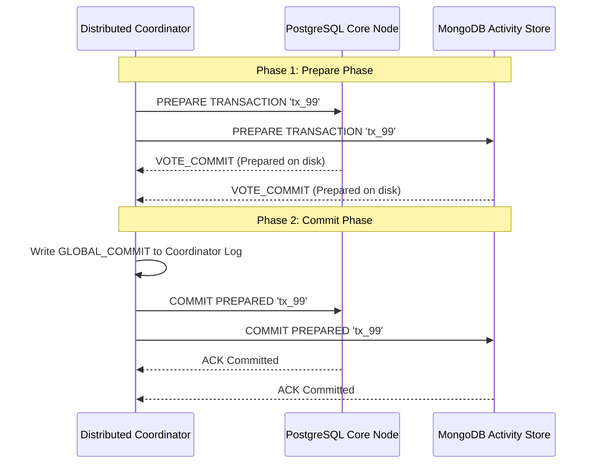

# Module 4 — Transactions & Concurrency Architecture

## Overview
Transactions and Concurrency are foundational to relational database management systems. In EduVault, academic records (enrollments, grades, tuition balances, degree auditing) demand absolute correctness and consistency while serving thousands of concurrent students, faculty, and administrative staff.

---

## 1. ACID Properties in EduVault

| Property | Definition | EduVault Implementation & Mechanism |
| :--- | :--- | :--- |
| **Atomicity** | "All-or-Nothing" execution. A transaction completes in its entirety or leaves the database completely unchanged. | Managed via PostgreSQL Write-Ahead Log (WAL), undo/redo pointers, and `SAVEPOINT` rollbacks. |
| **Consistency** | The database transitions from one valid state to another, strictly obeying all declared integrity constraints, foreign keys, and invariants. | Declared via table constraints (`CHECK (credits > 0)`, `CHECK (marks >= 0 AND marks <= 100)`, foreign keys on `student_id`). |
| **Isolation** | Intermediate modifications executed by one transaction remain invisible to other concurrent transactions until committed. | Governed by Multi-Version Concurrency Control (MVCC) snapshots and SQL isolation levels. |
| **Durability** | Once committed, all modifications survive system crashes, power cuts, or hardware failures. | Enforced by flushing the WAL buffer to non-volatile disk via `fsync` before reporting commit success. |

---

## 2. SQL Isolation Levels & Concurrency Anomalies

### Standard Concurrency Anomalies:
1. **Dirty Read (G1a)**: Transaction $T_1$ updates a row. Transaction $T_2$ reads that updated value before $T_1$ commits. If $T_1$ subsequently rolls back, $T_2$ acted on phantom/invalid data.
2. **Non-Repeatable (Fuzzy) Read (G1b)**: Transaction $T_1$ reads a row. Transaction $T_2$ updates that row and commits. When $T_1$ re-reads the row within the same transaction, it observes a different value.
3. **Phantom Read (A3)**: Transaction $T_1$ queries a range of rows matching a predicate (`WHERE course_code = 'CS101'`). Transaction $T_2$ inserts new rows satisfying the predicate and commits. $T_1$ re-executes the query and receives a different set of rows.
4. **Serialization Anomaly / Write Skew (G-skew)**: Distinct transactions read overlapping sets of data and make disjoint writes that together violate an invariant (e.g. at least one proctor on duty, or course capacity limit across combined lab/lecture sections).

### Comparison Matrix: ANSI SQL Standard vs PostgreSQL Implementation

| Isolation Level | Dirty Read | Non-Repeatable Read | Phantom Read | Serialization Anomaly / Write Skew |
| :--- | :--- | :--- | :--- | :--- |
| **Read Uncommitted** | Permitted in ANSI / **Prevented in PG** | Permitted | Permitted | Permitted |
| **Read Committed** *(PG Default)* | **Prevented** | Permitted | Permitted | Permitted |
| **Repeatable Read** | **Prevented** | **Prevented** | **Prevented in PG (via SI)** | Permitted (Write Skew) |
| **Serializable (SSI)** | **Prevented** | **Prevented** | **Prevented** | **Prevented (via SIREAD locks)** |

> [!NOTE]
> In PostgreSQL, specifying `READ UNCOMMITTED` transparently defaults to `READ COMMITTED`. PostgreSQL MVCC strictly prohibits dirty reads by design.

---

## 3. PostgreSQL MVCC (Multi-Version Concurrency Control)

Unlike lock-based database engines where readers block writers and writers block readers, PostgreSQL uses **MVCC**:
> **Readers never block writers, and writers never block readers.**

### Physical Tuple Header Anatomy:
Each row stored in a PostgreSQL table heap page contains hidden system attributes:
- `t_xmin`: The Transaction ID ($XID$) of the transaction that inserted the row version.
- `t_xmax`: The Transaction ID ($XID$) of the transaction that updated or deleted the row version ($0$ if active).
- `t_cid`: The command identifier within the transaction.
- `t_ctid`: A physical pointer `(page_number, item_offset)` identifying the tuple's storage location.

### How Updates Work Under MVCC:
An `UPDATE` in PostgreSQL does **not** overwrite data in place:
1. The old tuple has its `t_xmax` set to the updating transaction ID.
2. A completely new tuple is inserted into a free slot on the heap page with `t_xmin = updating_xid` and `t_xmax = 0`.
3. The old tuple's `t_ctid` is updated to point directly to the physical location of the new tuple.

### VACUUM and Garbage Collection:
- When transactions finish, superseded tuples where `t_xmax < oldest_active_xid` become **dead tuples**.
- `VACUUM` scans pages, clears dead tuple references, updates the Free Space Map (FSM), and prevents Transaction ID Wraparound (`vacuum freeze`).
- `VACUUM FULL` rewrites the entire table into a compact new file, returning unused space to the filesystem, but requires an `ACCESS EXCLUSIVE` lock.

---

## 4. PostgreSQL Lock Hierarchy

### Row-Level Locks:
- `FOR KEY SHARE`: Acquired by foreign key validation checks; blocks `FOR UPDATE`.
- `FOR SHARE`: Shared read lock; blocks `FOR UPDATE` and concurrent `DELETE`.
- `FOR NO KEY UPDATE`: Acquired by `UPDATE` modifying non-unique/non-key columns.
- `FOR UPDATE`: Exclusive row lock; acquired by `SELECT ... FOR UPDATE` or destructive operations.

### Table-Level Locks:
- `ACCESS SHARE`: Acquired by queries (`SELECT`).
- `ROW EXCLUSIVE`: Acquired by data manipulation (`INSERT`, `UPDATE`, `DELETE`).
- `SHARE`: Acquired by index creation (`CREATE INDEX`).
- `ACCESS EXCLUSIVE`: Acquired by schema modifications (`ALTER TABLE`, `DROP TABLE`, `TRUNCATE`).

### Advisory Locks:
Application-controlled mutexes managed directly inside PostgreSQL memory:
```sql
-- Session-level
SELECT pg_advisory_lock(1001);
-- ... critical section ...
SELECT pg_advisory_unlock(1001);

-- Transaction-level (auto-released on COMMIT/ROLLBACK)
SELECT pg_advisory_xact_lock(1001);
```

---

## 5. Deadlock Detection & Resolution

A deadlock occurs when two or more transactions hold locks that the others need in order to proceed, creating a cycle in the Wait-For Graph (WFG):
$$\text{Tx}_1 \xrightarrow{\text{waiting for}} \text{Tx}_2 \xrightarrow{\text{waiting for}} \text{Tx}_1$$

### Detection:
PostgreSQL initiates deadlock checking when a transaction has waited for a lock longer than `deadlock_timeout` (default: `1000ms` / 1 second).

### Resolution:
PostgreSQL computes cycle paths in the lock graph, selects the youngest or least expensive transaction, and terminates it with:
```text
ERROR: deadlock detected (SQLSTATE 40P01)
```

### Prevention Strategies:
1. **Strict Lock Acquisition Ordering**: All transactions acquire locks on multiple resources in the exact same deterministic order (e.g., sorting by primary key ascending).
2. **Explicit Timeouts**: Set `statement_timeout` or `lock_timeout`.
3. **Pessimistic Advisory Fences**: Use advisory locks to serialize high-risk workflows.

---

## 6. Two-Phase Commit (2PC)

Two-Phase Commit coordinates atomic transactions across distributed database nodes (e.g. PostgreSQL Core Node + MongoDB Learning Cluster).



---

## 7. Optimistic vs Pessimistic Concurrency Control

```text
+-----------------------+------------------------------------------+------------------------------------------+
| Dimension             | Pessimistic (PCC)                        | Optimistic (OCC)                         |
+-----------------------+------------------------------------------+------------------------------------------+
| SQL Pattern           | SELECT ... FOR UPDATE                    | WHERE id = 101 AND version = 5           |
| Locking Strategy      | Eager row locking upon read              | Lock-free reads, version check on write  |
| Contention Suitability| High contention (Hot rows)               | Low-to-moderate contention (Web queries) |
| Latency Profile       | Predictable queueing, higher wait times  | Near-zero read latency, retry on conflict|
| Deadlock Risk         | Possible if multiple rows locked         | Impossible during read phase             |
+-----------------------+------------------------------------------+------------------------------------------+
```
