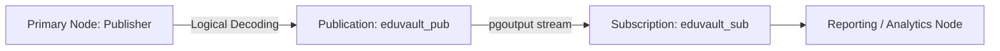

# Module 5 — Replication & Sharding Architecture

## Overview
As academic institutions expand, databases must scale beyond the capacity of a single physical machine. Module 5 explores high availability, disaster recovery, fault tolerance, read scaling, and horizontal data distribution.

---

## 1. Replication Patterns

### Synchronous vs Asynchronous Replication

```text
Synchronous Replication:
Client ──Write──> Primary ──Stream WAL──> Replica
                     │                       │
                     │<──────Flush ACK───────┘
                     ▼
                 (Committed)
Client <───200 OK───┘
Guarantee: Zero data loss (RPO = 0). Trade-off: Write latency equals local flush + network RTT.

Asynchronous Replication (PostgreSQL Default):
Client ──Write──> Primary ──Stream WAL (Async)──> Replica
                     │
                 (Committed locally)
Client <───200 OK───┘
Guarantee: Maximum throughput & instant local commit. Trade-off: Replication lag window (RPO > 0).
```

### Topology Paradigms:
1. **Single-Leader (Primary-Replica)**:
   - All writes route strictly to the Primary.
   - Replicas continuously ingest WAL and serve read-only queries (`Hot Standby`).
   - Automated failover requires consensus monitors (e.g. Patroni with etcd).
2. **Multi-Leader (Active-Active)**:
   - Multiple leaders accept writes in different regional data centers.
   - Requires conflict resolution policies: Last-Write-Wins (LWW) via timestamps or Conflict-free Replicated Data Types (CRDTs).
3. **Leaderless (Dynamo-Style)**:
   - No designated leader node. Clients or coordinators dispatch reads and writes concurrently to $N$ storage nodes.
   - Strict Quorum condition:
     $$W + R > N$$
     where $N$ = replication factor, $W$ = write quorum, $R$ = read quorum.
     Guarantees that at least one replica in the read quorum witnessed the latest write.

---

## 2. PostgreSQL Streaming Replication (Physical)

Physical streaming replication transfers binary WAL records directly from the primary `walsender` process to the standby `walreceiver` process.

### Primary Server Parameters:
```ini
# postgresql.conf
wal_level = replica
max_wal_senders = 10
wal_keep_size = 2048MB
synchronous_commit = on
synchronous_standby_names = 'FIRST 1 (standby_node_1, standby_node_2)'
```

### Standby Provisioning:
```bash
# Clone primary cluster image and create standby configuration
pg_basebackup -h primary_host -p 5432 -U repuser -D /var/lib/postgresql/data -Fp -Xs -P -R --slot=standby_slot_1
```
The `-R` flag automatically generates `standby.signal` and configures `primary_conninfo`.

### Monitoring Lag via `pg_stat_replication`:
```sql
SELECT 
    application_name,
    client_addr,
    state,
    sync_state,
    pg_wal_lsn_diff(sent_lsn, replay_lsn) AS lag_bytes,
    replay_lag
FROM pg_stat_replication;
```

---

## 3. PostgreSQL Logical Replication

Logical replication decodes Write-Ahead Logs into logical SQL change tuples, enabling granular, cross-version, and cross-platform data publishing.



### Key Differences: Physical vs Logical Replication

| Feature | Physical Streaming Replication | Logical Replication |
| :--- | :--- | :--- |
| **Unit of Replication** | Entire cluster (all DBs, schemas, indexes) | Selected tables or row subsets |
| **PostgreSQL Version** | Exact same major version & architecture | Cross-major version support (e.g. 14 -> 17) |
| **Target Node Mode** | Strictly Read-Only | Read-Write (accepts local writes and indexes) |
| **DDL Replicated** | Yes (physical disk block mirror) | No (table schemas must pre-exist) |
| **Primary `wal_level`**| `replica` | `logical` |

---

## 4. Database Sharding & Partitioning

Sharding partitions massive datasets horizontally across multiple independent database nodes.

### Sharding Strategies in EduVault:
1. **Hash-Based Sharding**:
   $$\text{Shard ID} = \text{MD5}(\text{student\_id}) \pmod{\text{Total Shards}}$$
   - **Advantage**: Perfectly uniform data distribution; eliminates hotspots.
   - **Trade-off**: Range queries require Scatter-Gather to all shards.
2. **Range-Based Sharding**:
   - Partitioning by Admission Year (`<= 2024`, `2025`, `>= 2026`).
   - **Advantage**: Fast range queries restricted to a single shard.
   - **Trade-off**: Risk of write hotspots (current year shard absorbs 100% of new enrollments).
3. **Directory / List-Based Sharding**:
   - Partitioning by Department (Computing, Electronics, Mechanical).
   - **Advantage**: Natural localized querying for departmental workloads.

### Query Routing & Scatter-Gather:
- **Point Queries with Shard Key**: Router directs SQL directly to target shard ($O(1)$ network hop).
- **Global Predicate Queries**: Router broadcasts SQL concurrently to all shards, gathers partial result streams, and performs coordinator merge-sort.
